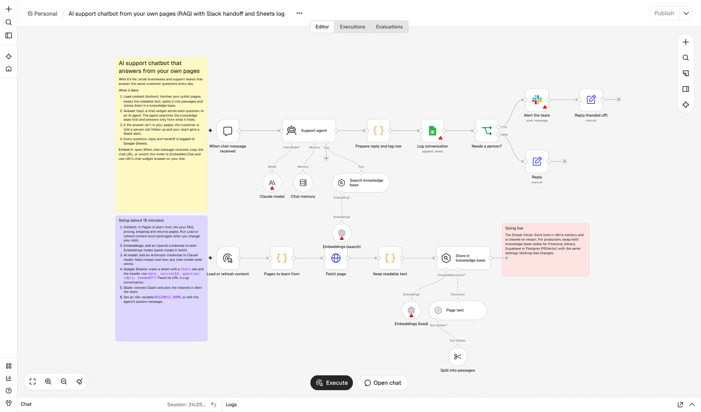

# n8n + AI automation templates

Production-minded n8n workflows for small businesses: AI that answers only from your own content, reads documents, and hands off to a person when it isn't sure. Every template imports into n8n as-is; credentials are left empty.

| Template | What it does | Stack |
|---|---|---|
| [AI support chatbot (RAG)](templates/ai-support-chatbot-rag-slack-sheets.json) | Website chat that answers from your own pages, hands off to Slack when the answer isn't there, logs every chat to Sheets | n8n AI Agent, Claude, OpenAI embeddings, Slack, Google Sheets |
| [PDF purchase orders → ERP CSV](templates/pdf-purchase-orders-to-erp-csv.json) | Reads emailed POs (scans, faxes, handwriting), validates customers, parts and prices against your data, writes one CSV per order and flags anything uncertain | IMAP, Claude (PDF input), Google Sheets/Drive, Slack |
| [Google Play review triage](templates/play-reviews-ai-triage-slack-sheets.json) | Classifies new reviews by severity, sends urgent ones to Slack, drafts replies, keeps a daily digest | Apify, Claude, Slack, Google Sheets |
| [Daily Play review alerts](templates/daily-play-review-alerts-to-slack.json) | Simple daily new-review alert | Apify, Slack |
| [Weekly hiring signals](templates/weekly-hiring-signals-to-slack.json) | Which target companies are hiring, posted to Slack weekly | Apify, Slack |

## Design rules used in every template
- **No guessing.** AI output is forced into a schema and checked against your data; anything unclear is flagged for a person.
- **No duplicates.** Re-runs and retried webhooks don't create second records.
- **No silent failures.** Errors and handoffs go to Slack.
- **Your accounts.** Everything runs in your n8n, with your keys.

## Demos
- Support chatbot, 43 s: [YouTube](https://youtu.be/4Uk6xBjRrGs) · [mp4](media/kettle-hill-chatbot-demo.mp4)
- PDF purchase orders → CSV, 36 s, from a real test run on a faxed, rotated scan: [YouTube](https://youtu.be/SBhhd1cgslQ) · [mp4](media/pdf-po-demo.mp4)

**PDF template test (Nov 2026, Claude Sonnet 5.5):** a clean system PDF passed with no flags; a faxed PO with a cover sheet, pages rotated 90° and scan noise was read correctly (PO number, all lines, carrier account) and its unknown part was flagged with the closest catalog match. About 5 seconds and 6k input tokens per PDF.

## Also on Apify
[Website to RAG Knowledge Base](https://apify.com/serkan1907/website-to-rag-knowledge-base): crawl a site's public pages into heading-aware chunks for the chatbot template.

## Need one adapted to your business?
These are starting points. For a version wired into your own tools (CRM, ERP, help desk), get in touch through the profile links on this account.

License: MIT
